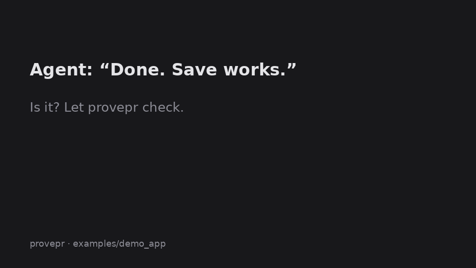

# orvix-provepr

**Your coding agent says it's done. provepr makes it prove it.**

Before an agent (Claude Code, Codex, Cursor, or anything that reads `AGENTS.md`) calls a change done or
opens a PR, it writes down what the change claims and how to check it. provepr runs those checks in a real
browser, against the app's HTTP API and as shell commands, and hands back facts: which step failed, HTTP 5xx
responses, page and console errors, command output, and screenshots of what went wrong. The agent fixes what failed and runs the checks again. By the time a human opens
the PR, each claim is marked PASS, FAIL or UNVERIFIED.

provepr never calls an LLM. The agent's own model writes the plan and reads the evidence. provepr only runs
the browser and reports what happened.

```
$ provepr run
# provepr run 20261018-042535-318161
1 PASS · 1 FAIL · 1 UNVERIFIED  (base_url http://127.0.0.1:8765)

## PASS `page-loads`: The profile page loads with a Name field and a Save button
- steps passed: 4/4

## FAIL `save-persists`: Clicking Save stores the name, and it is still there after a reload
- steps passed: 5/6
- FAILED step 6 `expect_value {"label": "Name", "value": "Ada Lovelace"}`: Locator expected to have Value 'Ada Lovelace' | Actual value:
- HTTP 500 POST http://127.0.0.1:8765/api/profile

## UNVERIFIED `name-length-limit`: The API rejects names longer than 100 characters
- no runnable steps (not checkable in a browser yet)
```

In that run the page showed "Saved" while the server returned a 500, so the bug would have shipped.
With provepr set up, Claude Code found and fixed it by itself (see [What it caught](#what-it-caught)).



**What makes it different:**

- **The agent can't quietly weaken its own proof.** `provepr check --base main` fails a PR that deletes a
  claim or loosens one of its checks, unless the plan says why under `waivers:`, in the diff for a human to see.
- **The proof stays.** Claims are committed in `.provepr/plan.yaml`, so they grow into a regression suite
  that CI re-runs on every PR, with no LLM and no test code to maintain.
- **It's cheap for the agent.** It reads a report of about 250 tokens and one image, not a browser
  session, so rerunning everything after a fix takes 2 turns
  ([benchmark](https://github.com/orvixx-labs/orvix-provepr/blob/main/bench/RESULTS.md)).
- **It tests the failure path.** `mock` steps fake a 500, a dropped network or a slow API, so "shows an
  error when saving fails" gets run, not just read.

Free and MIT licensed. It's early, and [feedback](https://github.com/orvixx-labs/orvix-provepr/discussions)
(especially what's missing or what would stop you using it) is the most useful thing you can give.

## Quick start

```
uv tool install orvix-provepr      # or: pipx install orvix-provepr
cd your-app && provepr init
```

`provepr init` sets the repo up so every agent and CI use provepr the same way:

| File | What it gets |
|---|---|
| `AGENTS.md` | A short managed block telling any agent to read `provepr docs` and follow the loop before calling a change done |
| `CLAUDE.md` | `@AGENTS.md`, so Claude Code reads the same rules |
| `.provepr/plan.yaml` | A starter plan. Set `base_url` and `start` to fit your app |
| `.github/workflows/provepr.yml` | A CI job that runs `provepr check --base <PR base>`, then `provepr run`, on every PR and uploads the evidence |
| `.gitignore` | `.provepr/runs/` and `.provepr/baseline/` |

Running it again changes nothing. Existing files are kept, except the marked AGENTS.md block and a CI
workflow you haven't edited, which are brought up to the installed version. After an upgrade, `provepr check`
and `provepr run` tell you when to rerun `init`.
After that, just ask your agent for changes as usual.

## How it works

```
 Coding agent (Claude Code / Codex / anything that reads AGENTS.md)
   │ 0. AGENTS.md says: read `provepr docs` (the guide bundled with the installed version)
   │ 1. writes the change + adds claims to .provepr/plan.yaml (the steps that prove them)
   │ 2. runs `provepr check`, then `provepr run` (or the run_proof MCP tool)
   ▼
 provepr
   ├─ starts the app (optional `start:` command) and waits for it
   ├─ runs each claim in headless Chromium: a screenshot after every step,
   │  console errors, page errors, every HTTP 4xx/5xx and failed request,
   │  plus `http` steps that call the app's API directly, `mock` steps that fake
   │  failing or slow requests, and `cmd` steps that run shell commands
   ├─ marks each claim PASS / FAIL / UNVERIFIED using fixed rules, no AI
   └─ writes the evidence bundle to .provepr/runs/<run>/
   ▼
 Agent reads a short report (about 250 tokens) and one contact sheet image
   └─ get_frames(claim) for screenshots of the failing step → fixes the code → runs again
```

**What counts as a failure.** A claim FAILs if a step fails, the page throws an uncaught error, a request
returns HTTP 5xx, or a request fails at the network level (requests a `mock` step faked on purpose are
left out). Console errors, HTTP 4xx responses and visual changes are listed for the agent to judge but do
not fail the claim. A claim with no steps is UNVERIFIED, never PASS.

**Why the plan comes first.** The agent decides what "working" looks like before it sees any evidence,
and the guide forbids weakening the plan to make it pass. An agent that grades its own work this way
is much harder to fool, including by its own optimism.

**Why the plan accumulates.** Each change adds claims and keeps the old ones, so `plan.yaml` grows into a
regression suite as a side effect, and CI runs all of it. `provepr check --base main` enforces it without
AI: a PR that removes a claim, or removes or changes one of its checks, fails unless the plan gives a reason
under `waivers:`, which then shows up in the PR diff.

**How agents learn the rules.** The guide for coding agents ships inside the package
([`src/provepr/docs/guide.md`](https://github.com/orvixx-labs/orvix-provepr/blob/main/src/provepr/docs/guide.md)), so it always matches the installed version.
Agents reach it through `provepr docs`, the `get_guide` MCP tool, or the plugin's skill. All three point to
the same file. `provepr check` enforces the parts a guide can't: unknown steps, unsafe ids, and claims
with no checks are rejected before anything runs.

## Install

You need [uv](https://docs.astral.sh/uv/). On first run provepr downloads Chromium for Playwright by itself.

### Any agent (AGENTS.md)

```
uv tool install orvix-provepr
provepr init
```

This works with any agent that reads `AGENTS.md` and can run shell commands.

### Claude Code

```
/plugin marketplace add orvixx-labs/orvix-provepr
/plugin install provepr@orvix
```

To load it for a single session from a local checkout: `claude --plugin-dir /path/to/orvix-provepr`.

### Codex

```
codex plugin marketplace add orvixx-labs/orvix-provepr
codex plugin add provepr@orvix
```

Or add it as a plain MCP server:

```
codex mcp add provepr -- uvx --from orvix-provepr provepr mcp
```

> Codex support has not been tested end to end yet. Claude Code has (see below). Please open an issue if it doesn't work for you.

## Use it

Ask the agent to prove its change works before it opens a PR, for example:

> Before you open the PR, prove the feature works with provepr and fix anything that's broken.

With `provepr init` done or the plugin installed, the agent learns the plan format and the loop from the
bundled guide: claims first, then check, run, read, fix, and run again.

### Writing a plan

```yaml
# .provepr/plan.yaml  (commit this; ignore .provepr/runs/)
base_url: http://localhost:3000
start: npm run dev          # optional; run from the project root, stopped after the run

claims:
  - id: save-persists
    says: "Clicking Save stores the name, and it is still there after a reload"
    steps:
      - goto: /settings
      - fill: { label: Name, value: Ada }
      - click: { role: button, name: Save }
      - expect_text: Saved
      - reload: true
      - expect_value: { label: Name, value: Ada }

  - id: name-too-long-rejected
    says: "The API rejects names longer than 100 characters"
    steps:
      - http: { method: POST, path: /api/profile, json: { name: "..." }, expect_status: 400 }

  - id: save-failure-shown
    says: "When saving fails, the page says so instead of 'Saved'"
    steps:
      - goto: /settings
      - mock: { path: /api/profile, method: POST, status: 500 }
      - click: { role: button, name: Save }
      - expect_text: Could not save

  - id: mobile-menu
    says: "On a phone, the menu opens from the hamburger button"
    viewport: mobile
    steps:
      - goto: /
      - click: { role: button, name: Menu }
      - expect_visible: { role: link, name: Settings }

  - id: cli-export
    says: "`mytool export` writes the profile as JSON"
    steps:
      - cmd: { run: mytool export --json, expect_output: '"name"' }
```

Most apps need a signed-in user. Sign in once in `setup`, and every claim starts signed in. Secrets come
from the environment as `${NAME}`, so they never end up in the committed plan, and their values are
replaced with `***` in the report. `before_each` resets data before every claim:

```yaml
setup:
  - goto: /login
  - fill: { label: Email, value: test@example.com }
  - fill: { label: Password, value: "${TEST_PASSWORD}" }
  - click: { role: button, name: Sign in }
  - expect_url: /dashboard

before_each:
  - cmd: { run: npm run db:reset }
```

A claim with `fresh: true` skips the sign-in, e.g. to check what signed-out visitors see.

Steps: `goto`, `click`, `fill`, `select`, `press`, `hover`, `check`, `uncheck`, `upload`, `reload`, `wait`,
`expect_text`, `expect_no_text`, `expect_visible`, `expect_value`, `expect_count`, `expect_url`, plus
`http`, `mock` and `cmd`. The full step and locator reference is in the guide: run `provepr docs`, or read
[`src/provepr/docs/guide.md`](https://github.com/orvixx-labs/orvix-provepr/blob/main/src/provepr/docs/guide.md).

### MCP tools

| Tool | Returns |
|---|---|
| `get_guide()` | the guide for coding agents (plan format, steps, rules) |
| `run_proof(plan_path?, base_url?, claims?, keep_evidence?, save_baseline?, compare?)` | the short report and one contact sheet image |
| `get_report(plan_path?, run?, include_json?)` | the latest (or a named) run's report, optionally with full JSON |
| `get_frames(claim_id, steps?, plan_path?, run?)` | screenshots of the failing step and the one before it, of the steps that look different from the baseline (with diffs), or of any steps you ask for |

### Command line

```
provepr init [dir] [--no-ci]                  # set up AGENTS.md, CLAUDE.md, plan, CI workflow, .gitignore
provepr docs                                  # print the guide for coding agents
provepr check [--plan PATH] [--base REF]      # validate the plan (and that nothing was removed since REF)
provepr run [--plan PATH] [--base-url URL] [--only ids] [--keep-evidence] [--save-baseline] [--compare]
                                              # exits 1 on any FAIL
provepr mcp                                   # serve the MCP tools over stdio
```

`base_url` resolves in this order: `--base-url`, then the `PROVEPR_BASE_URL` environment variable, then the plan.

### The evidence bundle

```
.provepr/runs/20261018-042535-318161/
├── report.md          what the agent reads
├── report.json        every step, error and timing
├── contact.png        one frame per claim, captioned PASS/FAIL
├── frames/<claim>/NN.png       screenshots (or terminal views, for `cmd`) the agent needs to fix a failure
├── frames/<claim>/NN.diff.png  with --compare: what changed since the baseline, in red
└── app.log            output of the `start` command
```

`report.md` and `report.json` are always written. A screenshot is taken after every step, but when the run
ends only the ones the agent needs are kept: for each FAILed claim, the failing step and the one before it,
plus any screenshot that looks different from the baseline. Passing claims keep only their tile in
`contact.png`. No video is recorded, and only the newest 5 runs are kept. On the demo app a run with one
failing claim takes 60 KB (24 KB of it the contact sheet), down from 168 KB with every frame and a video.
Use `--keep-evidence` to keep every screenshot and record a video per claim, e.g. to attach one to a PR.

### Visual changes against the base branch

```
git switch main && provepr run --save-baseline   # screens of every claim → .provepr/baseline/
git switch -    && provepr run --compare         # "looks different from the baseline at step 3" + diff images
```

Both runs happen on the same machine, so fonts and rendering match and only real changes show. A visual
change is reported, not judged: the agent decides whether it was intended.

## CI

`provepr init` writes `.github/workflows/provepr.yml`. It installs Chromium, runs `provepr check --base`
against the PR's base branch (so a PR can't quietly delete or loosen claims), runs every claim, and uploads
`.provepr/runs/` as a build artifact even when the job fails. The `start:` command in the
plan boots your app on the CI runner, so add the steps that install your app's dependencies where the
workflow's comment shows. Don't hand-write this file: `init` produces the same tested template everywhere.

## What it caught

`examples/demo_app` has a planted bug: the save handler reads the wrong JSON key, so every save returns
a 500, and the page shows "Saved" anyway. We gave Claude Code (headless, with this plugin) a fresh copy and
only this prompt:

> I built a profile page where you can type your name and save it. Before I open a PR, prove the feature
> works and fix anything that's broken.

It loaded the skill, wrote its own plan, ran it, and got a FAIL with the HTTP 500. It then fixed the server
**and** the UI that said "Saved" on a failed save, and ran again: `1 PASS · 0 FAIL`. In its final message
it listed the paths it could not check in a browser. That took 14 turns, and provepr made no LLM calls.

We repeated the test with **no plugin at all**, only the files `provepr init` writes, and a prompt that
never mentions provepr ("make sure it works and fix anything that's broken"). Claude Code read the rules
from AGENTS.md and ran `provepr docs`. It added two claims while keeping the existing one, used an `http`
step to check that bad input gets a 400, fixed both bugs, and finished at `3 PASS · 0 FAIL` in 13 turns.

Run the demo yourself:

```
cd examples/demo_app && uv run --project ../.. provepr run
```

## Why not just have the agent write Playwright tests?

You can, and for a big end-to-end suite you probably should. provepr is for the moment before that:
checking what *this* change claims, inside the agent's loop.

- **No test code to maintain.** A claim is a few lines of YAML that read like the PR description. There
  are no page objects, fixtures, async code or test runner config for the agent to get wrong.
- **Made for an agent to read.** A failing Playwright test prints a long trace. provepr returns which claim
  failed, the failing step, the HTTP 5xx behind it and two screenshots, in about 250 tokens.
- **It catches failures the steps didn't ask about.** A claim FAILs on any HTTP 5xx, uncaught page error
  or failed request, even if every step passed. In the demo the page said "Saved" and the server returned 500.
- **The agent can't edit its way to green.** `provepr check --base` fails a PR that removes or loosens a
  check without a written waiver. Agents writing their own test files can quietly weaken them.

If you outgrow it, the plan doubles as a written spec for the Playwright tests you write later.

## How it differs from other tools

- **Screen recorders for agents** capture what the agent did so a human can review it later. provepr checks
  claims the agent committed to beforehand and returns a pass/fail result the agent acts on.
- **Visual regression tools** (screenshot diffing) tell you pixels changed, not whether the feature works.
- **AI code reviewers** read the diff. provepr runs the change.

## Limits

- Web apps and command-line tools. Background jobs, email and native GUIs are UNVERIFIED.
- No steps yet for iframes, multiple tabs or pop-up windows, or drag and drop.
- Chromium only. Secrets are redacted in the report, but not in screenshots (password fields show dots).
- `check --base` compares checks exactly. It can't tell whether changing a non-check step (e.g. which
  page a `goto` opens) made a claim weaker; the plan diff in the PR shows that.
- The screenshot diff needs two local runs (base branch, then yours) and is not part of the CI template,
  because it boots the app twice.
- Runs locally. Hosted runs on PR preview deployments (a GitHub App) are on the roadmap.

## Roadmap

- [x] Local runner, evidence bundle, CLI
- [x] MCP server, skill, Claude Code and Codex plugin
- [x] Bundled agent guide, `provepr init` (AGENTS.md, CI workflow), `provepr check`
- [x] Accumulating plans, `--only`, `http` steps for API claims
- [x] Network mocking and failure steps in the browser (`mock`)
- [x] `provepr check --base main`: flag claims removed or weakened compared to the base branch
- [x] Screenshot diff against the base branch (`--save-baseline`, `--compare`)
- [x] Terminal and CLI apps (`cmd`)
- [x] Sign in once (`setup`), clean data per claim (`before_each`), secrets from the environment (`${NAME}`)
- [x] Phone screens (`viewport: mobile`), `hover`, `check`, `upload`, `expect_count`
- [ ] GitHub App: run on every PR against its preview deployment (Vercel, Netlify) and post a PR comment

## Contributing

See [CONTRIBUTING.md](https://github.com/orvixx-labs/orvix-provepr/blob/main/CONTRIBUTING.md).

## License

[MIT](https://github.com/orvixx-labs/orvix-provepr/blob/main/LICENSE) © Orvix Labs
